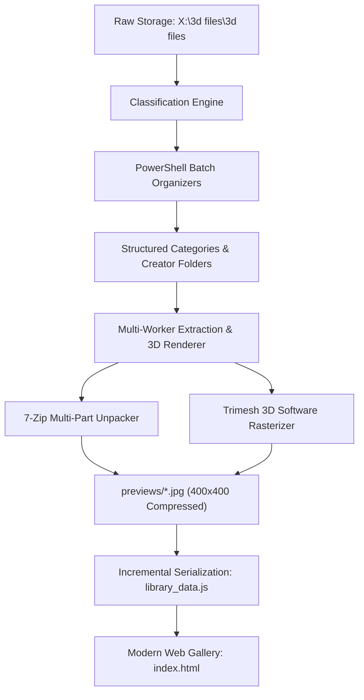

# 3D Printing Library Organizer & Visual Gallery

A high-performance automated cataloging system, deep 3D software rendering engine, and modern glassmorphic web gallery designed to organize, index, and visualize massive personal 3D printing collections (STLs, OBJs, and archive packs).

---

## 🌟 Key Features

- **Deep Archive STL Extraction & Rendering:**
  - Recursively inspects and extracts 3D meshes and preview renders from `.zip`, `.7z`, `.rar`, and multi-part split archives (`.7z.001`, `.zip.001`, `.z01` + `.zip`, `.part1.rar`).
  - Pre-filters unsupported vs. supported/pre-supported files to avoid cluttering the gallery with redundant slicing supports.
- **High-Performance Multi-Worker 3D Renderer:**
  - Custom software rasterizer built with `trimesh`, `numpy`, and `OpenCV`.
  - Orthographic projection, isometric camera angle (25° X / 40° Y), dynamic polygon decimation budget, and directional Lambertian surface lighting.
  - Automatically renders 3D STLs directly to compressed **400×400 JPEG** (`quality=80`) thumbnails, cataloging over **310,000+** 3D model previews while preserving storage.
- **Modern Glassmorphic Web Gallery (`index.html`):**
  - **Dark-Mode Glassmorphic Interface:** Styled with Outfit typography, JetBrains Mono accents, and glowing cyan accents.
  - **Real-Time Instant Search:** Instant debounced multi-field filtering across creator names, categories, and item contents.
  - **19 Category Filter Chips:** Fast navigation across `fantasy`, `sci fi`, `WWII`, `cyberpunk`, `terrain`, `bases`, `anime`, `historical`, `superheroes`, and more.
  - **Interactive File Explorer Modal:** Click any collection card to inspect its full file contents, featuring side-by-side file names, parent archive breadcrumbs (`Archive.zip ➔ Model.stl`), and high-resolution thumbnail cards.
  - **High-Efficiency Virtualized Rendering:** Handles collections with thousands of individual items without UI lag or DOM thrashing.

---

## 📂 Project Architecture

```
h:/webpage projects/persoanl 3d files organized/
├── index.html                           # Modern interactive web gallery application
├── library_data.js                      # Master catalog database (categories, creators, file lists, thumbnails)
├── previews/                            # Store of 400x400 rendered JPEG thumbnails (310,000+ images)
│   ├── 00a1b2c3d4e5.jpg
│   └── ...
│
├── render_fantasy_category.py           # Multi-worker parallel 3D extraction & rendering pipeline
├── deep_render_all_stls.py              # Global batch 3D rendering pipeline for all categories
├── archive_stl_renderer.py              # Core trimesh/OpenCV 3D rendering routines
├── build_full_gallery_thumbnails.py     # Gallery thumbnail generator & library_data.js serializer
│
├── classifier_rules.md                  # Studio taxonomies, codes, and naming rules (Skull Forge, OPR, etc.)
│
├── organize_3d_files.ps1                # PowerShell scripts for automated sorting of root loose files
├── organize_batch2.ps1 - batch8.ps1     # Incremental safe-move batches for creators and categories
├── organize_terrain.ps1                 # Dedicated terrain categorization script
├── organize_wwii.ps1                    # Dedicated WWII categorization script
├── organize_superheros.ps1              # Dedicated superhero categorization script
└── execute_batch_move.ps1               # Batch mover execution utility
```

---

## 🛠️ Supported File Formats

| Format Type | Extensions | Handling Method |
| :--- | :--- | :--- |
| **3D Meshes** | `.stl`, `.obj` | Software rendered with `trimesh` + `OpenCV` |
| **Standard Archives** | `.zip` | Processed via Python `zipfile` with direct stream decompression |
| **Advanced Archives** | `.7z`, `.rar` | Extracted via 7-Zip CLI (`7z.exe`) in isolated worker scratch spaces |
| **Split Multi-Part Sets** | `.7z.001`, `.zip.001`, `.z01` + `.zip` | 7-Zip multi-volume assembly extracting all spanning volumes |
| **Embedded Images** | `.jpg`, `.jpeg`, `.png` | Extracted and scaled to 400×400 letterboxed canvases |

---

## ⚙️ How the Pipeline Works



1. **Organization & Classification:**
   - Raw loose files from root directories are categorized based on naming patterns, studio tags, and rules in [`classifier_rules.md`](classifier_rules.md).
   - Safe PowerShell scripts move files into structured categories (`fantasy/artisan guild`, `sci fi/skull forge studios`, etc.).
2. **Multi-Worker Extraction & Rendering:**
   - A `ProcessPoolExecutor` scales across all available CPU cores.
   - Each worker operates in an isolated temporary scratch folder (`scratch/w_xxxxxxxx`).
   - For multi-part archives (e.g. `.7z.001`, `.zip.001`, `.z01`), 7-Zip detects and extracts the entire volume set.
   - Every `.stl` is loaded, positioned, lighted, and rendered to a 400×400 JPEG with MD5 content-addressable caching.
3. **Gallery Data Serialization:**
   - Results are incrementally committed to [`library_data.js`](library_data.js) every 5 finished collections to prevent data loss.
4. **Web UI Presentation:**
   - [`index.html`](index.html) loads [`library_data.js`](library_data.js) client-side with zero external server dependencies, providing instant filtering and modal model inspection.

---

## 🚀 Getting Started

### Prerequisites

- **Web Browser:** Google Chrome, Edge, Firefox, or Safari (no web server required; can be opened directly via `file:///`).
- **Python (for running the pipeline):** Python 3.10+
  - Required Python packages:
    ```bash
    pip install trimesh numpy opencv-python psutil
    ```
- **7-Zip (for archive unpacking):** Installed at `C:\Program Files\7-Zip\7z.exe` (or in system PATH).
- **Environment Configuration (Optional, for AI/OCR Metadata):**
  Copy `.env.example` to `.env` and set your API keys:
  ```bash
  cp .env.example .env
  ```

### Viewing the Gallery & Live Reassignment Server

1. **Quick Launch:** Double-click [`start_server.bat`](start_server.bat) (or run `python server.py`) to launch the local server and automatically open the gallery at `http://localhost:8000`.
2. **Reassigning Files from the Browser:**
   - In any collection or card view, click the **Move** button on any file/archive item.
   - Choose or type a destination **Category** and **Folder / Creator** name.
   - Click **Move File Now** — the file is physically moved on disk (`X:\3d files\3d files`), companion split volumes / preview renders are moved with it, and the web catalog updates in real-time with zero reload delay!
3. **Batch Moving Multiple Files:**
   - Inside any collection, click **Select Files to Move**. Check the items you want to migrate, and click **Move Selected Files...** in the bottom floating toolbar.
4. **Moving Entire Collections:**
   - Click **Reassign Folder** in the collection header to migrate the whole creator folder to a different category in one step.
5. **Interactive CLI / Terminal Tool (`reassign_file.py`):**
   ```powershell
   # Interactive terminal wizard:
   python reassign_file.py

   # Direct command-line move:
   python reassign_file.py --file "Model.zip" --to-cat "sci fi" --to-folder "StationForge"

   # Undo the last move operation:
   python reassign_file.py --undo
   ```

### Running the Parallel 3D Rendering Pipeline

To launch high-throughput multi-worker rendering:
```powershell
# Run with 8 workers across the entire library
python parallel_multicore_renderer.py --root "X:\3d files\3d files" --workers 8

# Skip models that already have existing thumbnails in previews/
python parallel_multicore_renderer.py --workers 8 --no-force

# Process a specific category or resume from a category
python parallel_multicore_renderer.py --category "sci fi" --workers 8
python parallel_multicore_renderer.py --start-category "smaller scale" --workers 2
```

### Running the Metadata Extractor (AI & Vision OCR)

To automatically extract release dates, studio themes, and model names from embedded archive covers and catalog renders:
```powershell
python metadata_extractor.py
```

---

## 💡 Engineering Highlights & Key Details

- **Studio Clay Lighting & Auto-Orientation:** The software rasterizer automatically detects flat baseplates and flips inverted models, centers the geometry, applies 3/4 hero camera elevation, and renders with dual-light studio clay shading.
- **Split Archive Support:** Multi-part split archives (`.7z.001`, `.zip.001`, `.z01` + `.zip`, `.part1.rar`) are unpacked via 7-Zip volume spanning.
- **Subprocess Byte Decoding:** 7-Zip stdout is decoded from raw bytes using UTF-8 with `errors='replace'` to safely handle non-CP1252 characters across massive archive sets without pipe buffer deadlocks.
- **Git Hygiene:** All generated thumbnails (`previews/`), worker scratch directories (`scratch/`), environment secrets (`.env`), and binary model assets are strictly excluded via `.gitignore`.

